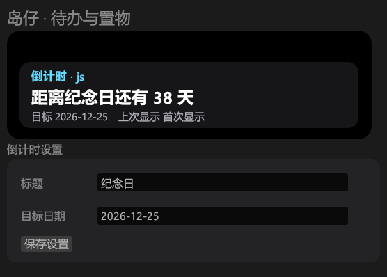
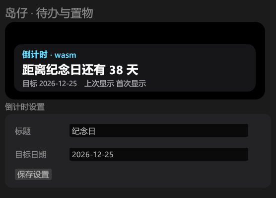

# 岛仔插件运行环境实测

**评审建议：首发优先考虑 QuickJS。** 岛仔已经随应用发布 QuickJS，作者可以用文本编辑器改脚本；WASM 的优势是 Rust 业务逻辑可以继续用 Rust 编写，指令额度也更容易重复测试。本次只验证同一款倒计时。一次加载十个实例的热中位数为 WASM 4.12 ms、QuickJS 12.28 ms；两者的体积增量分别为 1.163 MiB 和 0.152 MiB。如果首发作者主要是已有 Rust 模块的维护者，值得拿他们实际要迁移的模块再比较一次。最终选型由小唐决定。

## 同一款插件，两套实现

用户在「待办与置物」设置标题和目标日期，展开岛后看到“距离纪念日还有 N 天”。宿主提供按本地日历计算的目标日和今天的日期序号，插件算差值，先读上次显示值再存本次结果。宿主绘制卡片、校验配置并原子写盘。两个引擎各用自己的数据目录。对照样本使用同一套绘制、设置控件、刷新节奏和存储桥接。

| 真实窗口截图 | QuickJS | WASM |
| --- | --- | --- |
| 同一程序的独立验证窗口 |  |  |

截图由 eframe 渲染并读回帧缓冲。验证窗口调用与岛内实验入口相同的 `View::draw`、`View::settings`，独立运行便于复测。正常岛体的入口是 `--sdk-live`，在本次验证中临时使用待办页和对应设置页；正式模块注册、集市和通用设置渲染属于后续 SDK 工作。

## 同机对比

| 维度 | QuickJS · rquickjs 0.8.1 | WASM · wasmi 0.46.0 |
| --- | --- | --- |
| release 程序（默认 22,366,208 B） | 22,525,440 B；增加 **0.152 MiB** | 23,585,792 B；增加 **1.163 MiB** |
| 加载 1 个（首轮 / 热中位 / 热 P95） | 20.95 / **1.24** / 1.69 ms | 14.43 / **0.41** / 0.88 ms |
| 加载 10 个（首轮 / 热中位 / 热 P95） | 50.28 / **12.28** / 13.86 ms | 31.89 / **4.12** / 5.84 ms |
| 原生窗口每秒刷新一次，CPU | 4015.62 ms / 30.02 s（单核 13.378%） | 937.50 ms / 30.01 s（单核 3.124%） |
| 同一采样窗口的进程 CPU 周期数 | 9,930,499,926 周期 | 2,406,870,340 周期 |
| 进程工作集（中位 / 峰值） | 79.66 / 83.92 MiB | 80.24 / 80.87 MiB |
| 只刷新数据，无窗口（单核 CPU / 工作集中位） | 0.00 ms / 30.01 s；10.99 MiB | 0.00 ms / 30.01 s；11.07 MiB |
| 死循环 / 异常 / 超内存后 | 3/3 中止；同一实例均能再次刷新，死循环在 30.635 ms 返回 | 3/3 中止；同一实例均能再次刷新，死循环在 0.125 ms 返回 |
| 权限 | 未声明请求 -1、已声明 204；文件模块和直连网络入口不可用 | 未声明请求 -1、已声明 204；未注册的 WASI 文件导入链接失败 |
| 作者代码行数（倒计时 / 含故障用例） | 6 / 14 行；直接运行脚本 | 19 / 38 行；Rust 编译为 335 字节 WASM |
| 保存一行到出现新画面（单次） | 519 ms，含准备 0.9 ms | 2551 ms，含准备 2068.9 ms |
| 从本体抽取数字范围（原控件 1 行） | 新脚本 5 行代码；3/3 输入符合原范围 | 新 Rust 源码 16 行；3/3 输入符合原范围 |
| 依赖和 CI 实际运行 | 沿用既有引擎；本次跑过脚本、Windows 宿主编译、截图 | 锁文件新增可选解释器依赖树；本次额外安装 WASM 编译目标，编译、链接并运行两个插件样本 |

测量日期为 2026 年 11 月 17 日。基线提交 `efb8266`，Windows x64、Intel Core i5-12450H、12 个逻辑处理器、16 GB 内存。三份 exe 均用 Rust 1.96.1、同一份锁文件、同一 release 配置（LTO、单代码生成单元、剥离符号）。增量包含共用的验证窗口、命令行和测量代码。1 MiB = 1,048,576 字节。完整数据见[测量结果](evidence/results.json)、[QuickJS 加载原始样本](evidence/js-load.json)、[WASM 加载原始样本](evidence/wasm-load.json)。

加载计时包括读插件与配置、实例化、第一次回调和存储；10 个插件在同一进程内保持 10 份实例，同时存活。每组先跑一次，再重复 20 次取中位数与第 95 百分位。第一轮包含文件系统缓存状态的影响；时间从宿主开始装插件算起。运行开销按可见验证窗口每秒刷新一张卡测量，预热 3 秒后每秒取一次工作集，共 30 次。CPU 百分比按一个逻辑核折算，包含宿主、窗口事件、绘制和引擎，不能据一次低负载采样判断引擎快慢。作为对照，无窗口模式每秒调用同一条刷新路径，共完成 35 次，取中间 30 秒的 CPU 和工作集；Windows 进程 CPU 计时可能舍入到 0。修改时延从保存一行“天数 +1”算起，含必要的编译、重新启动验证窗口、读回并保存画面；另用独立进程核对天数确实增加。这里没有实现开发者模式的自动热重载。

## 故障、权限与重启

| 注入的情况 | QuickJS 实际返回 | WASM 实际返回 |
| --- | --- | --- |
| 死循环 | `Err(Exception)`；30.635 ms | `Err(Error { kind: TrapCode(OutOfFuel) })`；0.125 ms |
| 异常 | `Err(Exception)`；0.215 ms | `Err(Error { kind: TrapCode(UnreachableCodeReached) })`；0.003 ms |
| 内存上限 | `Err(Exception)`；0.246 ms | `Err(Error { kind: TrapCode(GrowthOperationLimited) })`；0.009 ms |
| 未声明联网 | `Ok(-1)`；0.816 ms | `Ok(-1)`；0.054 ms |
| 已声明模拟传输 | `Ok(204)`；0.007 ms | `Ok(204)`；0.019 ms |
| 直接文件访问 | `Exception generated by QuickJS` | `cannot find definition for import wasi_snapshot_preview1::path_open with type Func(FuncType { core: FuncType { params: [], results: [] } })` |

JS 为每个实例设置 4 MiB 堆、128 KiB 栈和 30 ms 中断期限。WASM 每次调用补充 100,000 单位指令额度，单实例限制一块 4 MiB 线性内存、一张最多 1,024 项的表，超限增长直接陷入错误。WASM 指令额度与墙钟时间没有固定换算。每次执行故障、拒绝请求或接受模拟请求后，测试都立即在**原宿主进程、原实例**刷新一次，要求它提交有效天数。

允许域名为 `allowed.example`；宿主在解析 HTTPS 地址、核对主机和端口后才进入内存传输端。未声明域名的调度次数增量必须为 0，允许域名必须为 1。文件探针分别尝试使用 JS 的文件模块、导入 WASI 文件函数；两者均未向插件提供操作系统文件句柄。本次没有发公网请求，也没有实现重定向、DNS 地址复核或生产文件选择器。故障演示覆盖脚本异常、指令耗尽和受限内存分配。引擎自身的原生崩溃、解析器漏洞或阻塞的宿主函数仍需独立进程与宿主侧限时兜底。

两套 release 程序各启动两次。QuickJS 首次返回 38 天、上次值为空，重启读回“旅行”、2026-12-25、上次 38 天；WASM 首次返回 38 天、上次值为空，重启读回“旅行”、2026-12-25、上次 38 天。

## 作者与维护者要改什么

- **倒计时源码。** [JavaScript 插件](../../spike/plugins/countdown.js)和 [Rust/WASM 插件](../../spike/plugins/countdown.rs)共享一份[样例配置](../../spike/plugins/settings.json)。显示文案、标题/日期输入和保存由宿主提供。实测行数按仓库内非空源码行计算；故障探针单列，Rust 计入无需标准库的入口和导入声明。
- **从健康设置拆一段。** 取现有 `src/extras.rs` 的喝水提醒数字控件，原调用 1 行，范围 5–180 分钟。生产设计把范围、单位和设置归属放到清单，宿主继续画原控件。本验证把日期差当作合成分钟输入，分别执行[脚本版](../../spike/migration/interval.js)和 [Rust 版](../../spike/migration/interval.rs)，测上下界与原有存储接口。两者都实测 4 → 5、45 → 45、181 → 180。抽样覆盖范围规则，完整喝水模块的通知排程、UI 和后台恢复未迁移。
- **依赖维护。** 现有中转站脚本使用 `rquickjs 0.8.1`，验证沿用锁文件。WASM 使用可选 `wasmi 0.46.0`，关闭默认特性，仅启用 std，不链接 WASI。查询时两项目均有 2026 年发行记录：rquickjs 0.14.0（9 月 18 日）、wasmi 2.0.0（9 月 1 日）。发布活动不能证明当前锁定版本仍获安全修复；正式接收社区代码前需评估升级，并复跑旧插件原包。上游记录见 [rquickjs](https://crates.io/crates/rquickjs/versions) 和 [wasmi](https://crates.io/crates/wasmi/versions)。
- **CI 与普通作者。** 两套宿主均用项目原有 Windows Rust/MSVC release 构建。JS 作者改文本即可；Rust 插件作者或重建其制品的 CI 需额外安装 `wasm32-unknown-unknown` 并将源编为字节码。普通用户安装现成 WASM 包无需此工具链。测量脚本另需 Python、psutil 及能创建原生窗口的 Windows 会话。宿主 SDK、权限和旧包回归仍是两种路线共有的维护工作。

## 本地复验

在此分支仓库根目录打开 PowerShell。默认构建不打开验证功能；下面分别构建并保留三份完整程序，每份使用同一份 Cargo.lock。

```powershell
$tc = '+stable-x86_64-pc-windows-msvc'
$triple = 'x86_64-pc-windows-msvc'
rustup target add wasm32-unknown-unknown --toolchain stable-x86_64-pc-windows-msvc
rustc $tc --target wasm32-unknown-unknown --crate-type cdylib -C opt-level=s -C panic=abort -C link-arg=-zstack-size=65536 -C strip=symbols spike/plugins/countdown.rs -o spike/plugins/countdown.wasm
foreach ($kind in 'base','js','wasm') {
    $features = @()
    if ($kind -ne 'base') { $features = @('--features', "sdk-$kind") }
    cargo $tc build --locked --release --bin daozai --target $triple @features
    if ($LASTEXITCODE -ne 0) { throw "构建失败：$kind" }
    Copy-Item "target/$triple/release/daozai.exe" "target/spike-$kind.exe"
}
cargo $tc test --locked --lib --target $triple -- --test-threads=1
```

- **试用设置与重启。** 运行 `./target/spike-js.exe --sdk-spike js ui`，把标题改为“发薪”，填入目标日期，点保存。关闭窗口后重开，可核对标题、日期和上次显示的天数。将文件名与参数里的 `js` 一起改成 `wasm` 即可对照。体验完整岛体时可在退出既有岛仔实例后运行 `./target/spike-js.exe --sdk-live js` 或 `./target/spike-wasm.exe --sdk-live wasm`；展开待办页看卡片，从待办对应设置调参数。
- **复测与截图。** 安装 Python 的 `psutil` 后运行 `python -X utf8 spike/measure.py target/review-01`。每次指定一个新目录，脚本复制样例供修改，测试设置、截图和原始数据均写到该目录。两次手工打开验证窗口默认共用临时目录下的 `daozai-sdk-spike/<引擎>/ui`；可用 `DAOZAI_SPIKE_DATA` 指向全新目录，`DAOZAI_SPIKE_PLUGINS` 指向自己的样例复制件。
- **回归。** 默认 release 构建成功；按任务指定命令运行现有库测试，1280 项通过、0 项失败，另有仓库原标记忽略的 129 项。SDK 验证单独运行，不计入这 1280 项。

正式权限和版本约定、建议值及待决定事项见 [SDK v1 设计评审稿](sdk-v1-design.md)。
